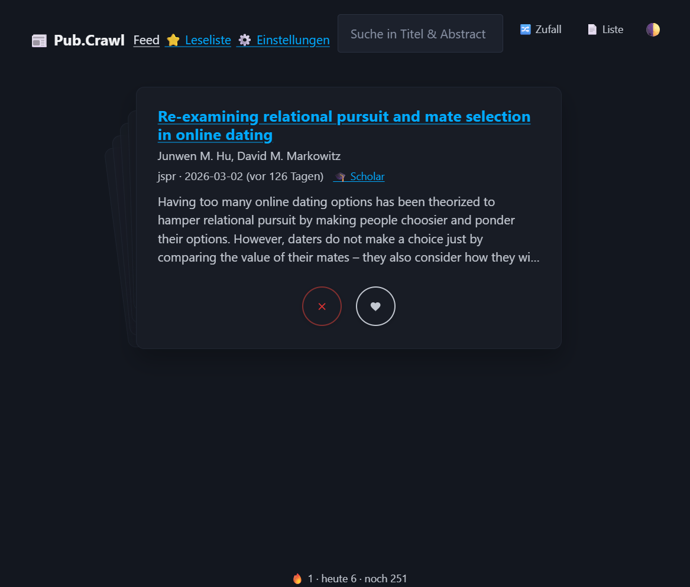
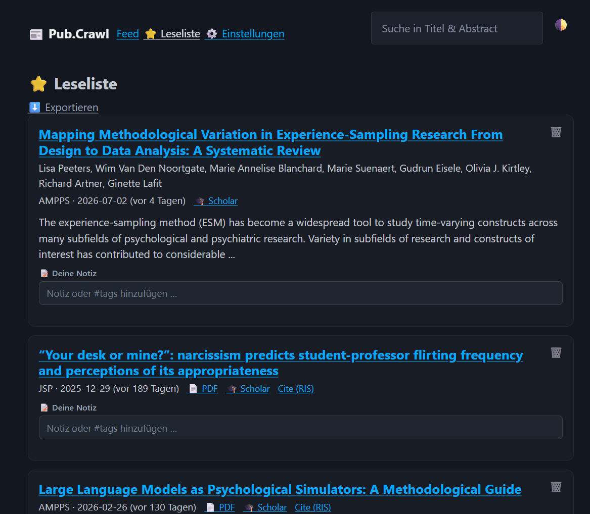

# Pub.Crawl

[](LICENSE)
[](https://pub-crawl.app)
<!-- Nach dem Zenodo-Release hier den DOI-Badge einsetzen:
[](https://doi.org/10.5281/zenodo.XXXXXXX) -->

Pub.Crawl helps you stay current with the literature. It aggregates journal RSS
feeds, lets you triage new papers by swiping through a card stack, and keeps the
ones you want in a reading list. It just crawls all the publications you want.

**→ Use it in your browser: [pub-crawl.app](https://pub-crawl.app)** — no install,
no account. Everything you do stays in your browser. On a phone, add it to the
home screen and it behaves like an app. ([Guide in German](https://pub-crawl.app/hilfe.html))

---

## Screenshots

> _Screenshots unter `docs/` ablegen (`feed.png`, `reading-list.png`) — dann erscheinen sie hier._

| Card stack (feed) | Reading list |
|---|---|
|  |  |

---

## What it does

- Reads 100+ curated psychology journals (social, cognitive, eye movements/gaze,
  clinical, developmental, …) or any RSS/Atom feed you add.
- Two views: a **card stack** (swipe right to keep, left to skip — on phones by
  finger) and a plain **list**. Everything is undoable.
- Sort by shuffle, newest-first, or **relevance** — a model that learns from your
  likes and skips, right in your browser, and shows which words made a paper match.
- Fills in **full abstracts and clean author lists** from CrossRef and OpenAlex when
  a feed only ships a citation stub; publisher boilerplate is filtered out.
- Per-paper links: Open Access via Unpaywall, Google Scholar, RIS export for
  citation managers, and sharing on phones.
- Reading list with notes, `#tags`, and a to-read / read split; full-list RIS export.
- Word filters ("only papers mentioning …", "hide papers mentioning …").
- One-file backup to move everything to another device or browser.
- Small extras: daily streak, dark/light mode, keyboard shortcuts.

## Two versions

| | **Browser** ([pub-crawl.app](https://pub-crawl.app)) | **Local** (Python) |
|---|---|---|
| Setup | none | Python + start script |
| Data | your browser (per device) | `dashboard.db` on your disk |
| Status | main version, actively developed | stable, feature-frozen |

The browser version lives in [`web/`](web/) (static files + a tiny Cloudflare
Worker that relays journal feeds). Backups can be moved between both versions.
The rest of this README describes the **local version**.

---

## Local version

A Flask app that runs entirely on your machine; no data leaves your computer.
State lives in a local SQLite database, configuration is a single YAML file.

### Install

```bash
git clone https://github.com/paulheineck/readr.git
cd readr
python -m venv .venv
.venv\Scripts\activate        # Windows
# source .venv/bin/activate   # macOS/Linux
pip install -r requirements.txt
```

### Run

Use the launcher for your OS — it sets up the virtual environment, installs
dependencies, waits for the server, and opens the browser:

```bash
"start Windows.bat"     # Windows
bash "start Mac.sh"     # macOS
bash "start Linux.sh"   # Linux
```

Or run it manually:

```bash
python app.py           # then open http://localhost:5000
```

On first start there are no feeds configured — the app links you to the catalog
to pick some. `config.yaml` and `dashboard.db` are created automatically. The
first load fetches feeds and abstracts in the background and shows a loading
screen; results are cached afterwards.

---

### Configuration

Feeds and filters live in `config.yaml`, but you rarely need to edit it by hand —
the **Settings** page covers adding feeds, the catalog, OPML, the allowlist, and
regex filters. (Journals that are only available via CrossRef — marked without a
`url` in `journals.yaml` — appear only in the browser version.) The file looks like this:

```yaml
feeds:
  - name: PSPB
    url: https://journals.sagepub.com/action/showFeed?type=etoc&feed=rss&jc=psp
  - name: Nature Human Behaviour
    url: https://www.nature.com/nathumbehav.rss

filters:
  include: []                                  # empty = keep all
  exclude:
    - "(?i)erratum|corrigendum|call for papers"
  journal_allowlist: []                        # empty = show all feeds

display:
  max_items_per_feed: 30
  show_abstract: true

api:
  unpaywall_email: ""                          # optional, for Open-Access lookups
```

`config.yaml` is per-user and not tracked in git; it is created from
`config.example.yaml` on first run.

---

### Keyboard shortcuts

| Key | Action |
|---|---|
| `l` | Like / add to reading list |
| `d` | Skip / hide |
| `j` / `k` | Move down / up (list view) |
| `/` | Focus search |
| `?` | Show shortcut help |

---

### Project layout

```
├── app.py                # Flask backend (feeds, metadata, relevance, routes)
├── templates/
│   ├── index.html        # feed / reading list UI
│   ├── sources.html      # settings
│   └── loading.html      # first-start loading screen
├── config.example.yaml   # template, copied to config.yaml on first run
├── journals.yaml         # curated journal catalog
├── verify_feeds.py       # checks catalog feeds for reachability
├── web/                  # browser version (pub-crawl.app), see web/README.md
├── start Windows.bat / start Mac.sh / start Linux.sh
├── requirements.txt
└── dashboard.db          # local state (auto-created, gitignored)
```

### Dependencies

Flask · feedparser · PyYAML · beautifulsoup4 · requests · python-dateutil · APScheduler

---

### Notes

- Some publishers (e.g. Elsevier, Springer) don't share abstracts in their feeds;
  Pub.Crawl then falls back to CrossRef/OpenAlex, which covers most but not all papers.
- Abstract/metadata lookups are cached for 7 days in `dashboard.db`.
- Set `FLASK_DEBUG=1` to run in debug mode; otherwise it runs with debug off.

---

## Citation

If Pub.Crawl is useful for your work, a citation is appreciated. GitHub shows a
**“Cite this repository”** button, driven by [`CITATION.cff`](CITATION.cff).

```bibtex
@software{heineck_pubcrawl,
  author  = {Heineck, Paul},
  title   = {Pub.Crawl — A Research Feed Reader},
  year    = {2026},
  url     = {https://pub-crawl.app},
  version = {1.0.0},
  doi     = {10.5281/zenodo.XXXXXXX}
}
```

To mint a DOI: sign in to [zenodo.org](https://zenodo.org) with GitHub, enable
this repository under **Account → GitHub**, then publish a GitHub release
(`git tag -a v1.0.0 -m "Pub.Crawl 1.0.0" && git push origin v1.0.0`, then
"Draft a new release" for that tag). Zenodo archives the release and issues a DOI;
paste the badge into this README and `CITATION.cff`.

---

## License

MIT License © 2026 [Paul Heineck](https://github.com/paulheineck)
